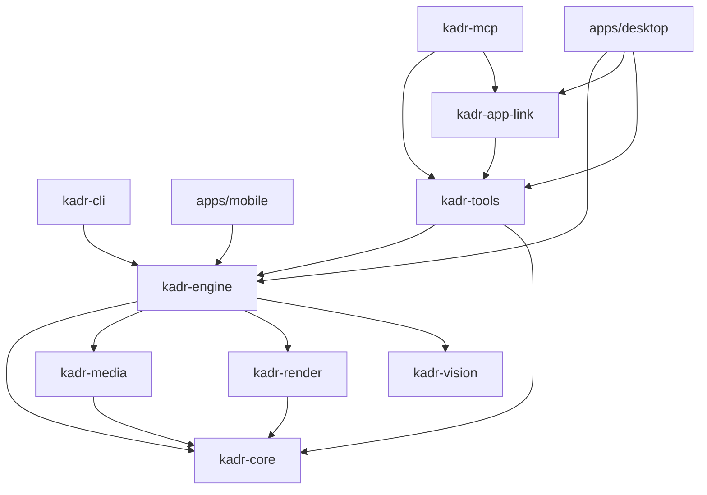
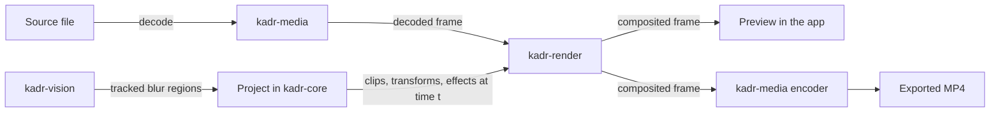
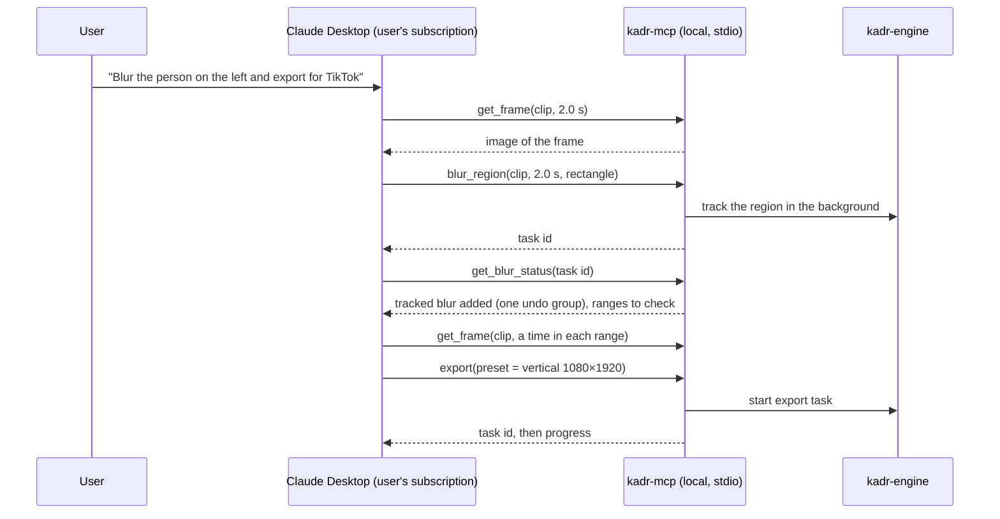

# Architecture

Kadr is a Cargo workspace. The engine is split into small crates with one job each,
and **user interfaces only talk to `kadr-engine`**. This is what lets the same engine
run behind the desktop app, the command line, the MCP server and, later, the Android
app.

## The crates

| Crate | Job | Phase |
|---|---|---|
| `kadr-core` | Data model: project, timeline, tracks, clips, effects, keyframes, undoable commands, project file | 1 |
| `kadr-media` | Probing, decoding, encoding; thumbnails and waveforms. FFmpeg on desktop, MediaCodec on Android, behind the same traits | 2 |
| `kadr-render` | Compositing the image of the timeline at a given time, on the GPU (`wgpu`) | 2 (CPU), 3 (GPU) |
| `kadr-vision` | Classic computer vision, no AI: region tracking for face blur, optical flow, silence detection | 4 |
| `kadr-engine` | The single API for interfaces: projects, commands, preview, background tasks with progress and cancellation | 2 → |
| `kadr-tools` | Editing tools Claude can call: name, description, JSON schema, execution | 5 |
| `kadr-mcp` | Local MCP server (stdio) exposing `kadr-tools` to Claude Desktop / Claude Code | 5, 7 |
| `kadr-app-link` | The local pipe between `kadr-mcp` and the open desktop app: one tool call, one answer ([decision 0030](decisions/0030-claude-edits-the-open-app-through-a-local-pipe.md)) | 7 |
| `kadr-cli` | Command-line binary to test the engine without an interface | 0 → |
| `apps/desktop` | Tauri 2 desktop app: Svelte front end, Rust back end (crate `kadr-desktop`) calling the engine. See [desktop-app.md](desktop-app.md) | 6 |
| `apps/mobile` | The same Tauri 2 app built for Android | 9 |

## Planned dependencies

An arrow means "depends on". Dependencies are declared in `Cargo.toml` only when the
code starts using them (Cargo warns about unused ones and CI fails on warnings). Since
phase 2, `kadr-cli → kadr-engine → kadr-media / kadr-render → kadr-core` are real;
since phase 4, `kadr-engine → kadr-vision` (region tracking, and silence analysis
since phase 5); since phase 5, `kadr-mcp → kadr-tools → kadr-engine / kadr-core`
too (`kadr-mcp` also uses `kadr-engine` directly, for the FFmpeg backend the engine
re-exports). Since phase 7, `kadr-mcp` and the desktop app both use `kadr-app-link`
(`kadr-mcp` passes calls through it, the app answers them with its own `kadr-tools`
toolbox). The others arrive with their phase.

`kadr-vision` deliberately depends on nothing: its algorithms work on plain image and
audio buffers, so each one can be tested alone on synthetic data.

## Rules that keep the Android port possible

- `kadr-core`, `kadr-render`, `kadr-vision`, `kadr-engine` and `kadr-tools` never
  depend on Tauri, on a UI library or on a Windows-only API.
- Platform-specific media code (FFmpeg, MediaCodec) lives behind traits in `kadr-media`.
- GPU code uses `wgpu`, which runs on Vulkan, DirectX 12, Metal and OpenGL ES.

## How a frame travels (phase 2: CPU; phase 3: GPU)

Details, sync rules and measured performance: [media-and-export.md](media-and-export.md).

Colour LUT files (`.cube`) are read by `kadr-engine` (`color_grading`, which keeps
them between frames and reads a file again when it changes) and parsed and applied by
`kadr-render` (`color_lookup_table`, on the CPU and the GPU); the project only names
the file (decision record 0052).

Preview and export use the same renderer, so what the user sees is what they get: the
desktop app's preview frames come from `kadr_engine::preview`, which composes frames
with the export's own code and only shrinks the result to the panel's size (see
[desktop-app.md](desktop-app.md)).

## How Claude edits a project (from phase 5)

No request ever goes from Kadr to Anthropic. See
[decisions/0004-claude-through-local-mcp-only.md](decisions/0004-claude-through-local-mcp-only.md)
and, for the tools and their rules, [mcp-server.md](mcp-server.md).
