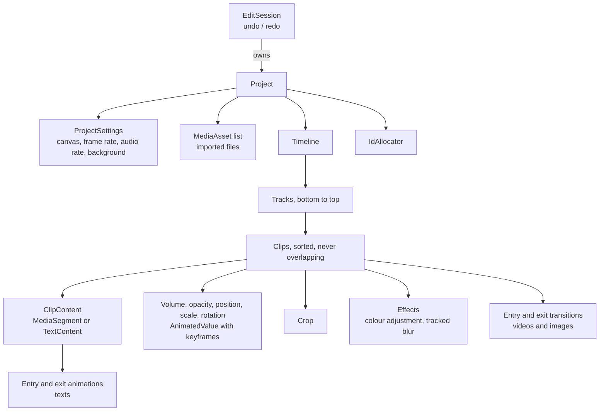

# Data model

This is a guided tour of `kadr-core`: what a project is made of, how it changes, and
how it is saved. Every type mentioned here is documented in detail by
`cargo doc -p kadr-core --open`.

## The big picture



## Time

Video editing needs exact time. Kadr counts time in integer **ticks**:
1 second = 705 600 000 ticks (one tick is a *flick*). Frame durations of every common
frame rate (24, 25, 30, 50, 60, 120 fps, NTSC 30000/1001…) and sample durations of
every common audio rate (44.1 kHz, 48 kHz…) are whole numbers of ticks, so cuts land
exactly on frames.

| Type | Meaning |
|---|---|
| `Timestamp` | A point in time, on the timeline or in a source file |
| `TimeSpan` | A length of time |
| `FrameRate` | An exact fraction, e.g. `30000/1001`; converts frame numbers ↔ timestamps |

Floating-point seconds only appear at the edges: reading input from a person or from
Claude (`Timestamp::from_seconds(2.5)`), and displaying values (`12.345 s`).

## Identifiers

Every media file, track, clip and effect gets a number from a **single counter**
(`IdAllocator`) stored in the project. Numbers are never shared between two objects,
even of different kinds, so "object 12" is never ambiguous. Each kind has its own type
(`ClipId`, `TrackId`, `MediaAssetId`, `EffectId`), so they cannot be mixed up.

## Media assets

A `MediaAsset` describes an imported file: path, display name, kind (video, audio,
image), duration, picture size, frame rate and audio format. Still images have no
duration and can be shown for any length of time. `kadr-media` fills these
descriptions in when importing (phase 2).

## Timeline, tracks and clips

- Tracks are stacked **bottom to top**: for video, track 0 is drawn first and each
  following track on top of it.
- A **video track** holds videos, images and texts. A video clip also plays its sound.
- An **audio track** holds anything with sound (music, voice-over, or the sound of a
  video).
- On one track, clips are sorted by start time and **never overlap**.

A `Clip` has:

| Field | Meaning |
|---|---|
| `content` | `Media(MediaSegment)`: a range of a source file (`source_start`–`source_end`) played at a `PlaybackSpeed`; or `Text(TextContent)`: words, duration and style |
| `timeline_start` | Where the clip starts on the timeline |
| `volume_multiplier`, `opacity` | Animatable values |
| `transform` | Position (from the canvas centre), scale (1 = fits the canvas), rotation, crop |
| `effects` | Applied in order |
| `entry_transition`, `exit_transition` | How a video or image enters and leaves the picture (fade, slide, zoom) |

A text's content also holds its `entry_animation` and `exit_animation` (fade, slide,
pop, type-on, word by word). Both are explained in
[transitions-and-text-animations.md](transitions-and-text-animations.md).

The duration of a media clip is computed, not stored: source range ÷ speed. Speeds are
exact fractions too (1.5× is stored as 3/2).

## Animation

An `AnimatedValue` is either a constant or a curve defined by `Keyframe`s. Keyframe
times are measured **from the start of the clip**, so moving a clip moves its
animation. Between two keyframes the value follows the first keyframe's
`Interpolation` (decision record 0054):

| Curve | Shape (p: share of the time between the keyframes) |
|---|---|
| `Linear` | p |
| `EaseIn` | p²: starts slowly |
| `EaseOut` | 1 − (1 − p)²: slows down as it arrives |
| `EaseInOut` | 3p² − 2p³ (smoothstep) |
| `Hold` | keeps the value, then jumps to the next one |
| `CubicBezier` | a curve shaped by two handles, as CSS `cubic-bezier(x1, y1, x2, y2)` |

- A Bézier curve's handles (`BezierHandle { time_fraction, progress_fraction }`) are
  from 0 to 1 on both axes: the curve never goes back in time, and **every value
  stays between its two keyframes**, so the rule on keyframe values covers every
  moment. Its value is found by Newton's method, then bisection, in `f64`; preview
  and export both call `AnimatedValue::value_at`.
- `Interpolation::as_bezier_curve` gives the Bézier shape of each preset (handles at
  ⅓ and ⅔), so a curve editor can start from it without changing anything.
- Splitting a clip splits its animations: each part gets a keyframe at the cut, so
  linear and hold animations look exactly the same afterwards; an eased or Bézier
  stretch containing the cut follows the same curve again over each shorter part.
- Trimming the start shifts the keyframes so the animation stays aligned with the
  picture.
- Changing the speed keeps keyframes where they are on the timeline.
- Setting a constant value on an animated property is refused: set a keyframe instead.

## Effects

| Effect | What it stores |
|---|---|
| `ColorAdjustment` | Exposure (stops), contrast, saturation, temperature |
| `ColorLut` | The path of a `.cube` file and a strength from 0 to 1. Only the path is stored, never the table; the rules check only that it names a `.cube` file, never that it exists (a moved LUT must not make the project impossible to open). Reading it is the engine's job ([rendering.md](rendering.md#colour-luts), decision record 0052) |
| `TrackedBlur` | Style (gaussian, pixelate, solid fill), shape (rectangle, ellipse), margin, edge softness, and `RegionSample`s: where the hidden region is, **indexed by source time** so the blur stays on the face after trims and splits, with the tracker's confidence (confident, uncertain, lost) and who placed it (user, tracker, manual correction) |

Whatever the order of a clip's effects list, they apply in a fixed order: tracked
blurs on the source picture, then the colour adjustments (in list order), then the
colour LUT.

## Commands and undo

A project can be read freely but **only changed through commands**. Each command is
a small struct implementing `EditCommand`:

- `apply` either succeeds or fails **without changing anything**;
- `revert` restores the project exactly, including the identifier counter, so redo
  gives back the same identifiers.

| Area | Commands |
|---|---|
| Project | `ChangeProjectSettings` |
| Media | `ImportMedia`, `RemoveMedia` (refused while clips use it) |
| Tracks | `AddTrack`, `RemoveTrack`, `SetTrackMuted`, `SetTrackHidden` |
| Clips | `AddClip`, `RemoveClip`, `MoveClip`, `TrimClip`, `SplitClip`, `RemoveClipParts` (cut ranges out and close the gaps on the clip's track: silence removal), `SetClipSpeed`, `SetClipPropertyValue`, `SetClipCrop`, `SetClipText` |
| Keyframes | `SetKeyframe` (add, or replace the one at that moment), `MoveKeyframe` (keeps its value and curve; may pass others, never lands on one), `RemoveKeyframe` (`.keeping_the_value_when_last()` keeps the last keyframe's value instead of the value from before the animation) |
| Effects | `AddEffect`, `RemoveEffect`, `ReplaceEffect`, `SetEffectEnabled` |
| Transitions | `SetClipTransition`, `SetTextAnimation` |

### The edit session

`EditSession` owns the project and the history:

- `execute(command)` applies one command as one undo step;
- `transaction(label, |transaction| …)` applies several commands as **one** undo step,
  all or nothing — a request from Claude that changes ten things is undone with a
  single Ctrl+Z;
- `execute_all(label, commands)` does the same for a ready-made list and says which
  step failed;
- `undo()`, `redo()`, `next_undo_label()`, `undo_history_labels()`.

After every command, the session runs `validate_project`. If a rule is broken, the
command is reverted and refused with `EditError::WouldMakeProjectInvalid`, whose
message names the objects involved, for example:

> the change was refused: clips 4 and 7 overlap on track 2 between 6.000 s and 8.000 s

## The rules (validation)

`validate_project` is the single place where every rule lives. It runs after every
command and on every loaded file.

- Settings: canvas sides between 16 and 8192 pixels and **even** (required by H.264),
  frame rate up to 240 fps, a standard audio sample rate.
- Identifiers: unique, and all smaller than the counter's next value.
- Media descriptions consistent with their kind.
- Clips: on a track of the right kind, showing an existing media file, inside the
  file's duration, not empty, not overlapping.
- Texts: not empty, a font name, a size between 1 and 2000 pixels.
- Properties: inside their ranges (opacity 0–1, volume 0–4, scale 0.01–100…),
  keyframes in strictly increasing time order, Bézier handles from 0 to 1.
- Crop: each edge from 0 to below 1, opposite edges not removing the whole picture.
- Effects: picture effects only on clips with a picture, tracked blur only on media
  clips, settings in range, region samples sorted and well formed.
- Transitions only on videos and images, text animations only on texts; both last
  more than zero and at most 60 s (longer than the clip is fine: they are shortened
  to fit when drawn).

## The project file

A `.kadr` file is indented JSON:

```json
{
  "format_version": 4,
  "project": {
    "settings": { "canvas_size": { "width_in_pixels": 1080, "height_in_pixels": 1920 }, … },
    "media_assets": [ … ],
    "timeline": { "tracks": [ … ] },
    "id_allocator": { "next_raw_id": 17 }
  }
}
```

Times are stored as integer ticks. Colours are written `#RRGGBBAA`. A complete example
is kept as a snapshot test in
`crates/kadr-core/tests/snapshots/editing_scenarios__vertical_interview_project_file.snap`.

- `save_project_to_json` writes the file text; `load_project_from_json` reads it.
- When the format changes, `CURRENT_FORMAT_VERSION` goes up and a `Migration` is added;
  older files are upgraded step by step when loaded.

  | Version | Change |
  |---|---|
  | 1 | First format (phase 1) |
  | 2 | `entry_transition` and `exit_transition` on clips, `entry_animation` and `exit_animation` on texts (phase 8) |
  | 3 | The `color_lut` effect (phase 8c). Nothing to convert: the new number makes an older Kadr say "newer version" instead of "damaged file" |
  | 4 | The keyframe curves `ease_in`, `ease_out` and `{"cubic_bezier": {…}}` (phase 8e). Nothing to convert, for the same reason |

  The snapshots of versions 1, 2 and 3 are kept as
  `crates/kadr-core/tests/fixtures/vertical_interview_format_1.kadr`, `…_format_2.kadr`
  and `…_format_3.kadr`; tests check they still open as the same project.
- A file from a **newer** Kadr is refused with a message asking to update, rather than
  losing data.
- Every loaded project is validated: a damaged file never reaches the editor.
- Writing to disk is left to `kadr-engine` (phase 2).
