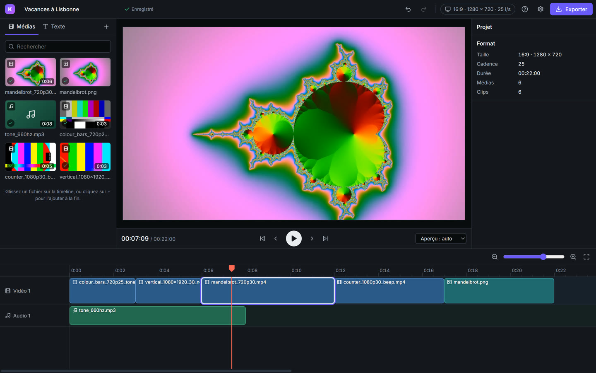
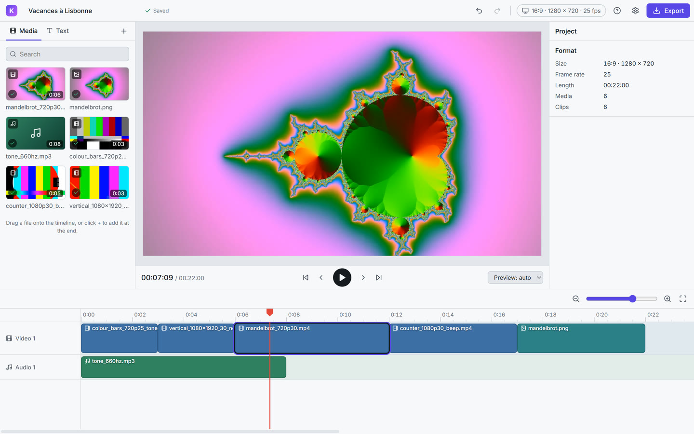
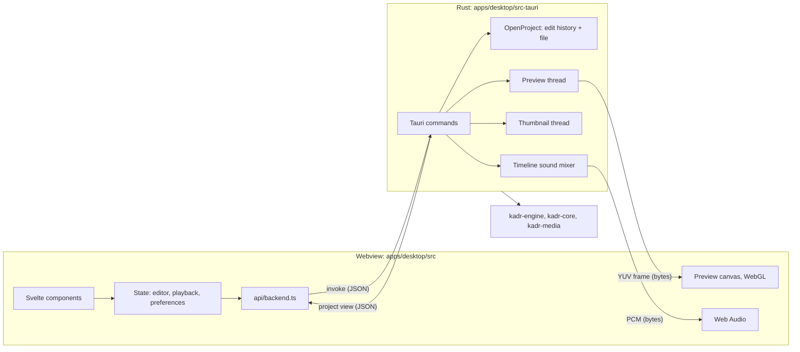
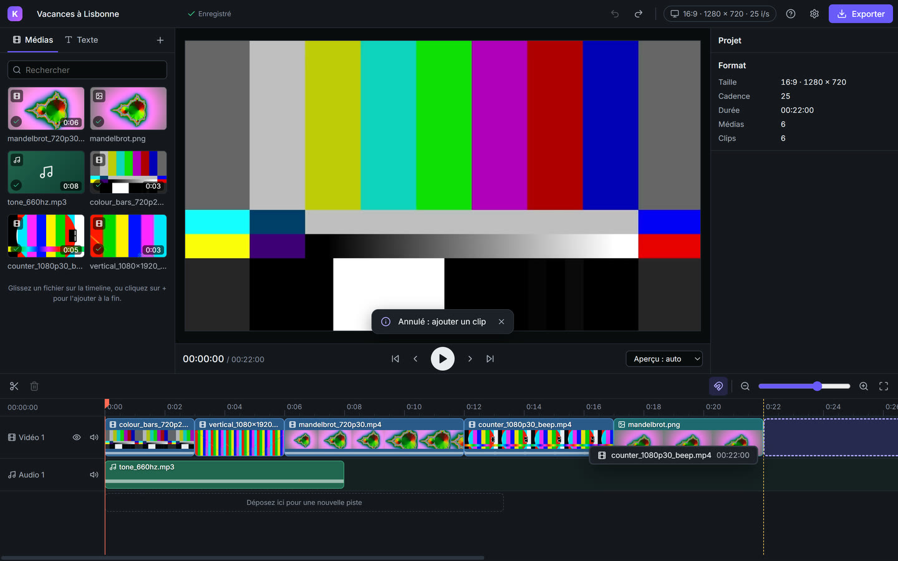
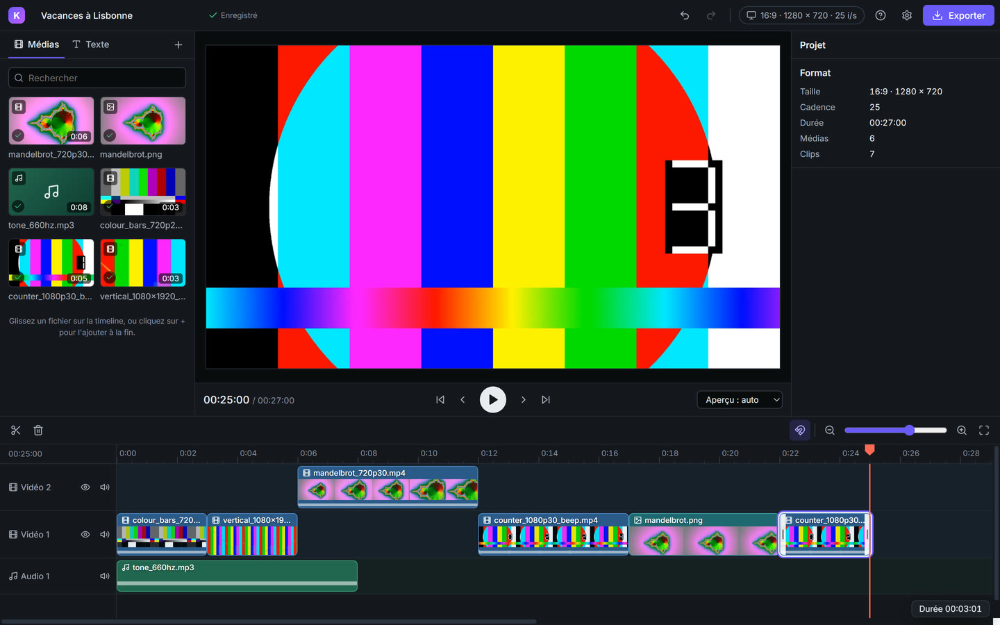

# The desktop app

How the Kadr desktop app is built. What it looks like and how it behaves is in
[ux.md](ux.md) and [design-system.md](design-system.md); the choices behind it are
decision records [0020](decisions/0020-svelte-typescript-front-end.md),
[0021](decisions/0021-desktop-app-layout.md) and
[0022](decisions/0022-front-end-and-engine-communication.md).





## Running it

You need the Rust and FFmpeg setup of the [README](../README.md#setting-up-windows)
and Node.js 20.19 or newer. From `apps/desktop/`:

```powershell
npm ci
```

```powershell
npm run tauri dev
```

The first build compiles the whole engine and Tauri (several minutes); later ones
take seconds. The front end reloads by itself when a `.svelte` or `.ts` file changes;
a change in Rust rebuilds and restarts the app.

| Command (in `apps/desktop/`) | What it does |
|---|---|
| `npm run tauri dev` | The app with live reloading |
| `npm run tauri build` | An optimised app and its installer (`target/release/bundle/`) |
| `npm run check` | Type check of the front end (`svelte-check`, no warning allowed) |
| `npm test` | Front-end unit tests (`vitest`) |
| `npm run build` | Builds the front end alone into `dist/` |

The Rust side is a workspace crate like the others: `cargo clippy`, `cargo test` and
`cargo doc` at the root cover it.

### Driving the running app from a script

To check the app without clicking by hand, start it with the WebView's debugging port
open, then talk to it with the Chrome DevTools Protocol (Node 22 has `WebSocket`
built in):

```powershell
$env:WEBVIEW2_ADDITIONAL_BROWSER_ARGUMENTS = '--remote-debugging-port=9222'
npm run tauri dev
```

`http://127.0.0.1:9222/json` lists the page; `Runtime.evaluate`, `Input.dispatchKeyEvent`,
`Input.dispatchMouseEvent` and `Page.captureScreenshot` do the rest. Things learned
doing it:

- `window.__TAURI_INTERNALS__.invoke` is read-only: it cannot be replaced to fake an
  answer. Every call goes through `fetch("http://ipc.localhost/<command>")`, which can
  be wrapped, for example to answer `plugin:dialog|open` with chosen files instead of
  opening the native dialog.
- Ctrl+I without that opens the real dialog, which a script cannot close.
- A file drop from the explorer can be imitated by emitting Tauri's own event:
  `invoke("plugin:event|emit", { event: "tauri://drag-drop", payload: { paths, position } })`.
- Real clicks (`Input.dispatchMouseEvent`) are better than `element.click()`: they
  also show hover states and go through pointer events.

## The two halves



### Back end (`src-tauri/src/`)

| Module | Role |
|---|---|
| `open_project.rs` | The project being edited: `EditSession` (undo / redo), its `.kadr` file, the revision counter, the snapshot shared with the worker threads. **Every change goes through `OpenProject::edit`**, which saves the file afterwards |
| `editing.rs` | `EditRequest`: what the interface can ask, and the rules each request follows (for example *add at the end of the first track of the right kind*). One request is one undo step; undo labels are keys the front end translates |
| `project_view.rs` | `ProjectView`: the description the front end draws, rebuilt after every change, with tracks in display order and computed clip lengths |
| `media_workers.rs` | The preview and thumbnail threads, which own their decoders (FFmpeg's are not `Send`). The preview thread renders only the newest waiting request |
| `binary_messages.rs` | The byte layouts of frames, thumbnails, waveforms and sound |
| `commands/` | The Tauri commands, thin calls into the above and `kadr-engine` |
| `recent_projects.rs` | The home screen's list, in the app's configuration folder |
| `command_error.rs` | Errors with a stable code the front end translates, plus the engine's details |

### Front end (`src/`)

| Folder | Role |
|---|---|
| `lib/api/` | Typed calls to the commands (`backend.ts`), the shared types (`types.ts`), binary decoders |
| `lib/state/` | `editor` (project view, playhead, selection, imports), `playback` (clock and sound), `preferences` (language, theme, interface size), `toasts` |
| `lib/components/` | Screens and panels: home, top bar, library, preview, inspector, timeline, dialogs |
| `lib/ui/` | Reusable components: buttons, icon buttons, dialog, key caps, notifications, icons |
| `lib/i18n/` | French and English texts (`messages.en.ts` defines the keys, `messages.fr.ts` must translate all of them) |
| `lib/styles/` | Design tokens (`tokens.css`) and base styles |
| `lib/time/`, `lib/timeline/` | Ticks, frames and timecodes; time ↔ pixels and ruler steps (unit-tested) |

The front end holds **no project data of its own**: it draws the latest project view
and sends requests. Selection, playhead and zoom are its only state.

## Preview

1. The preview panel asks for the frame at the playhead, at the size it shows it
   (panel size × screen pixel ratio, or a fixed fraction of the canvas when the
   quality is set to full, 1/2 or 1/4).
2. `render_preview_frame` takes a snapshot of the project and queues a job on the
   preview thread. If newer jobs are already waiting, older ones are answered
   *superseded*: scrubbing never builds a backlog.
3. The thread renders with `kadr_engine::preview::PreviewRenderer`, which uses the
   **same frame composition as the export** (decoders, renderer, effects), then
   shrinks the frame with a box filter.
4. The YUV planes travel as raw bytes; WebGL 2 uploads them as three textures and a
   shader converts BT.709 limited range to RGB.

The panel asks for one frame at a time and always for the newest position, so a slow
frame makes the preview skip, never lag.

## Playback

Web Audio is the clock. Pressing play:

1. fetches the first second of mixed sound (`get_timeline_sound`, mixed by
   `kadr_engine::timeline_sound::TimelineSoundMixer` exactly like the export);
2. starts the clock 60 ms later and schedules that second at an exact time;
3. at every screen refresh, computes the playhead from the audio clock, and fetches
   the next second whenever less than two are scheduled ahead.

A chunk that arrives late starts part-way through so it stays in sync. Each clip's
sound is decoded once, whole, and kept (up to about ten minutes of sound), so
playing again starts at once. J and L play at 2× and 4× when pressed again (the
sound is sped up with its pitch); backwards play has no sound and uses
`performance.now()` as its clock. Any edit restarts playback from the playhead with
the new sound.

## Thumbnails and waveforms

- Thumbnails come from the thumbnail thread (`ThumbnailMaker` keeps the six most
  recent decoders open) as RGBA bytes, drawn on small canvases. The front end keeps
  the last 600 in memory, by file path, time and size.
- Waveforms are decoded once per file at 8 kHz and reduced to 100 peaks per second
  (one byte each), kept by the back end and the front end.

## Projects on disk

- New projects go to `Documents/Kadr/<name>.kadr`; a taken name gets a number.
- The project is saved after **every** change (atomic write: a temporary file, then a
  rename). A failed save shows *Not saved* in the top bar with the reason; the next
  change, or Ctrl+S, tries again.
- Renaming the project renames its file. The recent list follows renames.

## Editing on the timeline

Every gesture is worked out in the front end while it happens and sent as **one**
request when it ends, so one gesture is one undo step:

- **Rules during a gesture** live in `src/lib/timeline/placement.ts`, as pure,
  tested functions: snapping (clip edges, the playhead and the start, within 8 screen
  pixels), overlaps, which tracks accept a clip, trimming limits (the other edge, the
  file's length, the neighbours), and the cut times for ↑ / ↓.
- **`TimelinePanel`** shows the result before anything is sent: a ghost where the
  clip would land (red, with the reason, when it cannot), the yellow snapping guide,
  the length while trimming. Clips are dragged with pointer events, not HTML drag
  and drop (see the pitfalls in `CLAUDE.md`).
- **Media dragged from the library** cross two panels: `state/mediaDrag.svelte.ts`
  holds the gesture, the library starts it, the timeline previews and places the
  clip, and the editor screen draws the badge under the pointer.
- **The back end** (`editing.rs`, `editing/arrangement.rs`) turns each request into
  `kadr-core` commands in one transaction. The engine checks everything again: the
  front-end rules only make refusals visible before the release.
- Pointer positions go through `pointerOffsetX` (`src/lib/ui/pointer.ts`), because
  the interface size setting zooms the page.





## Adding an edit

1. Add a variant to `EditRequest` in `editing.rs`, with a test, and a branch in
   `apply_edit_request` that runs `kadr-core` commands inside one transaction whose
   label is a key (`"splitClip"`).
2. Add the same shape to `EditRequest` in `src/lib/api/types.ts`.
3. Add `undo.<label>` to both message files.
4. Call `editor.edit({ type: "…", … })` from the component.

## Languages

`t("key", { name })` returns the text in the current language. The language follows
the system (French if it is French, English otherwise) until the user picks one in
the settings. Default track names from the engine ("Video 2") and undo labels are
translated on display; error codes from the back end map to `error.<code>` texts.
