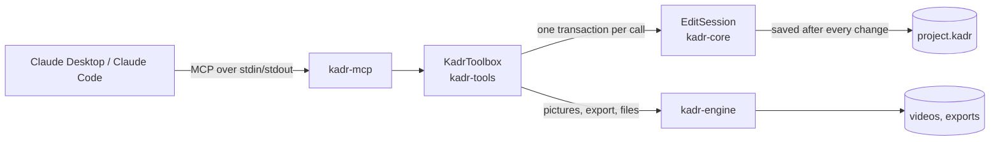

# The MCP server: Claude edits videos in Kadr

Kadr ships a local **MCP server**, `kadr-mcp`. The user adds it to Claude Desktop or
Claude Code, describes the edit in their own conversation, and Claude calls Kadr's
tools on their computer. **No API key, no extra cost**: a regular Claude
subscription is enough, and Kadr never talks to Anthropic
([decision 0004](decisions/0004-claude-through-local-mcp-only.md)).

Setup for users is in the [README](../README.md#editing-with-claude). This page is
the reference: how the server works, every tool and its rules.

## How it fits together

- **`kadr-tools`** defines every tool once: name, description written for a
  language model, JSON schema of its parameters (generated with `schemars` from a
  Rust struct), and the code. It has no MCP dependency, so the desktop app can
  reuse it ([decision 0010](decisions/0010-mcp-server-with-rmcp.md)).
- **`kadr-mcp`** serves them with the official Rust SDK, `rmcp`, over stdio. Each
  call runs on a blocking thread, one at a time. Nothing but the protocol is
  written to stdout; logs go to stderr (`KADR_LOG=debug` for more).
- **File mode** (phase 5): the server edits a `.kadr` file directly and saves it
  after every successful change
  ([decision 0012](decisions/0012-file-mode-saves-every-change.md)). Phase 7 will
  connect it to the open desktop app instead.

## Rules every tool follows

| Rule | How |
|---|---|
| Units | Times in **seconds** (timeline time unless the name says otherwise, for example `source_start_in_seconds`). Sizes and positions in **pixels**, origin at the **top-left corner**, x to the right, y down. |
| One call = one undo step | Each changing call is one transaction labelled `Claude: …` in the history; `undo` reverts a whole call. |
| Clear errors | Failures are tool results with `isError: true` and a sentence saying what to do, listing the valid choices: *clip 999 does not exist; existing clips: 3, 5, 8*. Unknown or misspelt parameters are reported, not ignored. |
| Allowed folders only | Paths must be absolute and inside a folder given with `--allowed-folder` (checked after resolving links and `..`) — see [decision 0011](decisions/0011-allowed-folders-as-server-arguments.md). Media paths stored in a project are checked too. |
| No silent overwrite | An existing file is only replaced with `"overwrite": true`. A project file changed by another program since Kadr read it is never overwritten: the call is refused and Claude reopens it. |
| No deletion | No tool deletes a file. Removing clips, tracks or media only changes the project. |
| Pictures for Claude | JPEG, longest side at most **1024 pixels**, with the original size and the factor to convert measured positions back to original pixels. |
| Long tasks | `export` and `blur_region` answer at once with a task id (`export-1`, `blur-1`); `get_export_status` and `get_blur_status` follow them, `cancel_export` and `cancel_blur` stop them. |
| Snapping | A clip edge given within half a frame of another clip's edge on the same track snaps onto it, so a time copied with rounding (`1.999999`) does not overlap by a microsecond. |

## The tools

### Project

| Tool | What it does |
|---|---|
| `get_project_info` | Open project (file, size, frame rate, duration, counts), what undo/redo would do, recent history, allowed folders. Works without a project: call it first. |
| `create_project` | New `.kadr` file, opened at once. `canvas`: `vertical_1080x1920`, `landscape_1920x1080` (default), `landscape_3840x2160`, `square_1080x1080`, or `width_in_pixels` + `height_in_pixels`; `frames_per_second`; `overwrite`. |
| `open_project` | Opens a `.kadr` file (warns about media outside the allowed folders). |
| `save_project` | Saved already after every change; with `file_path`, "save as" and continue in the copy. |
| `set_project_settings` | Canvas size (preset or custom), frame rate, background colour. |
| `undo`, `redo` | One whole tool call at a time. |

### Media

| Tool | What it does |
|---|---|
| `find_media_files` | Searches the allowed folders (or one `folder`) for videos, sounds and images; `name_contains`, `kind`, `include_subfolders`, `maximum_results`. Says which files are already imported. |
| `probe_media` | Kind, duration, picture size, frame rate, sound, without importing. |
| `import_media` | Imports `file_paths` in one undo step; a file already imported returns its existing `media_id`. |
| `list_media` | The project's media and the clips using each. |

### Timeline

| Tool | What it does |
|---|---|
| `get_timeline` | Canvas, duration, tracks from the bottom up with a line per clip. |
| `get_clip` | Everything about one clip: times, source range, speed, volume, opacity, placement (`center_x_in_pixels`/`center_y_in_pixels` on the canvas, `scale`, rotation, crop), text style, animations, effects. |
| `add_track` / `remove_track` | `kind` video or audio, `name`, `position` top or bottom. Removing a track removes its clips (undoable). |
| `add_clip` | Places a media: whole file by default, or `source_start_in_seconds`–`source_end_in_seconds`; at the end of the first track of the right kind (created if needed) or at `start_time_in_seconds` / on `track_id`; `duration_in_seconds` for still images (default 5). |
| `remove_clip` | With `close_gap`, later clips of the same track move earlier (ripple delete). |
| `move_clip` | New start, optionally another track. |
| `trim_clip` | New start and/or end on the timeline; moving the start also moves the source start, so the picture stays in sync. |
| `split_clip` | Cuts at a timeline time; the second part gets a new `clip_id`. |

### Clip properties

| Tool | What it does |
|---|---|
| `set_clip_speed` | 0.1× to 16×, sound keeps its pitch; `shift_later_clips` moves the following clips along. |
| `set_clip_volume` | Multiplier 0 to 4. If the clip has a sound fade, the fade keeps its shape. |
| `set_transform` | Centre on the canvas, `scale` (1 = fits inside), `fit` `fit_inside` / `fill_canvas` (computes the covering scale, for example a landscape video in a vertical project), rotation, opacity, crop fractions. |

### Content

| Tool | What it does |
|---|---|
| `add_text` | A text from `start_time_in_seconds` for `duration_in_seconds`, on a "Texts" track above the videos; size (default canvas height ÷ 16), colour, font, alignment, centre position. |
| `edit_text` | Words and style of a text clip. |
| `add_transition` | `fade_in`, `fade_out` or `dip_to_black` (this clip out, the next clip of the track in), as opacity keyframes — and volume keyframes with `include_sound`. A fade out ends one frame early so its last frame is fully faded. Cross-dissolves come with phase 8. |
| `remove_transitions` | Removes a clip's opacity and volume keyframes. |
| `add_color_adjustment` | Exposure (stops), contrast, saturation, temperature; with `effect_id`, changes an existing one. |
| `remove_effect` | Removes one effect. |

### Seeing the video

| Tool | What it does |
|---|---|
| `get_frame` | Without ids: the **finished timeline picture** (what the export shows). With `clip_id`: the clip's **source picture** at a timeline time, tracked blurs applied, before placement — positions on it are source pixels, the coordinates of a blur rectangle. With `media_id`: a file's picture at a time into the file. |
| `get_contact_sheet` | 2 to 48 thumbnails (default 12) evenly spread over a media file, a clip or the finished timeline, each labelled with its time, in one picture of at most 1024 pixels. |

Single pictures are drawn with the CPU renderer: starting the GPU takes longer than
drawing a frame. The pixel work is in `kadr_engine::still_frames`.

### Blurring a face

| Tool | What it does |
|---|---|
| `blur_region` | Hides what is inside a rectangle (a face, a plate, a screen) through a whole video clip. The rectangle is given on **one** frame: `clip_id`, `time_in_seconds` (timeline time, as for `get_frame` with `clip_id`), `left_in_pixels`, `top_in_pixels`, `width_in_pixels`, `height_in_pixels` in the clip's **source** pixels. Optional `style` (`gaussian_blur`, `pixelate`, `solid_fill`), `strength_in_pixels`, `fill_color`, `shape` (`ellipse` or `rectangle`), `margin_in_percent`. Answers at once with a task id (`blur-1`). With `effect_id`, **corrects** that blur instead: the rectangle is where the region really is at that time, and tracking restarts from there. |
| `get_blur_status` | With `task_id`: running (percent, time left), finished (the blur's `effect_id`, frame counts, **ranges to check**), failed (why) or cancelled. With `clip_id`: the clip's tracked blurs and their ranges to check. Without either: everything. |
| `cancel_blur` | Stops a running analysis; nothing is added. |

How Claude uses them:

1. `get_frame` with the `clip_id` at a time where the face is clearly visible; Claude
   measures the face on the picture and converts it to source pixels with the factor
   the answer gives.
2. `blur_region` with that rectangle; `get_blur_status` every few seconds (a minute of
   1080p takes about 10 s).
3. When the analysis ends, **the toolbox adds the tracked blur to the project** as one
   undo step labelled `Claude: Blur a region on clip 4`. It does so at the start of the
   next tool call, and `kadr-mcp` also does it every second between calls, so the file
   is saved even if the conversation stops there. The answer of the next call (other
   than `get_blur_status`) ends with *"Meanwhile, in the background: blur-1
   finished…"*.
4. The status lists the **ranges to check**: stretches where the tracker was
   *uncertain* (it probably followed the region; the hidden area was widened) or
   *lost* (hidden, out of the picture; the blur stays where the region was last
   seen), in timeline seconds, each with a `look_at_time_in_seconds`. Claude looks at
   them with `get_frame` (blurs are applied on its pictures).
5. Where the face shows, `blur_region` with the blur's `effect_id`, a time in the range
   and the rectangle there: the analysis runs again from that frame up to the
   neighbouring anchors, and only replaces what it does better (see
   [tracking-and-blur.md](tracking-and-blur.md#correcting-a-tracked-blur)). One undo
   step: `Claude: Correct blur 7 on clip 4`.

Mistakes are refused before anything runs: a rectangle outside the picture or too
small (the sizes are given in the video's pixels), a clip that is not on screen at
that time, a strength out of range, an unknown blur. An analysis that ends after its
project was closed, or whose clip was removed meanwhile, fails with the reason and
changes nothing.

### Sound

| Tool | What it does |
|---|---|
| `detect_silences` | The silent parts of a file (`media_id`, times into the file) or of a clip (`clip_id`, times in the file and on the timeline): quieter than `threshold_in_decibels` (default −40 dBFS) for at least `minimum_silence_in_seconds` (default 0.5). Changes nothing; `remove_silences` cuts them. |
| `remove_silences` | Shortens every silence of a clip (same settings, plus `kept_pause_in_seconds`, default 0.2) to a short pause, in one undoable step (`RemoveClipParts`): the clip becomes pieces end to end (the first keeps the `clip_id`), later clips of its track move earlier, other tracks do not move. Reports the cuts, the pieces and how far later clips moved. Decision record 0051. |

The loudness is the RMS level of 10 ms windows, computed by
`kadr_vision::silence_detection` on the sound decoded piece by piece at 16 kHz by
`kadr_engine::silence_analysis`.

### Export

| Tool | What it does |
|---|---|
| `export` | MP4 (H.264 + AAC) in the background; answers with a task id. `preset`: `project` (default, the project's size), `tiktok_reels_shorts` (1080×1920), `youtube_1080p`, `youtube_4k`, `custom` (`width_in_pixels`, `height_in_pixels`). `quality` `balanced` or `fast`; `overwrite`. |
| `get_export_status` | Running (percent, estimated time left), finished (path, duration, encoder, renderer, warnings), failed (reason) or cancelled; without `task_id`, every export. |
| `cancel_export` | Stops an export; its file is not created. |

A preset of the **same shape** as the project but another size scales the whole
project for the export (positions and text sizes, which are in canvas pixels; video
scales are relative to the canvas, blur regions are in source pixels, crops are
fractions). A preset of **another shape** is refused with the way forward: change
the project with `set_project_settings`, check the framing with `get_frame`, then
export. Changing the shape silently would export something Claude never looked at.

## Examples of conversations

> **User:** In my Videos folder there is an interview. Make a 30-second vertical
> clip of the best part with a title, and export it for TikTok.
>
> **Claude:** `get_project_info` → `create_project` (vertical_1080x1920) →
> `find_media_files` (name_contains "interview") → `import_media` →
> `get_contact_sheet` → `add_clip` (source range) → `set_transform` (fill_canvas)
> → `add_text` → `get_frame` to check → `export` (tiktok_reels_shorts) →
> `get_export_status` until finished.

> **User:** Cut the part from 1:12 to 1:20 and fade out the end.
>
> **Claude:** `get_timeline` → `split_clip` at 72 → `split_clip` at 80 →
> `remove_clip` (close_gap) → `add_transition` (fade_out).

> **User:** Cut the silences of the interview.
>
> **Claude:** `remove_silences` (clip_id) → `get_contact_sheet` around a few cuts to
> check that no word was clipped.

> **User:** Blur the face of the person on the left in the interview, then export
> for TikTok.
>
> **Claude:** `get_timeline` → `get_frame` (clip_id, a time where the face is
> visible) → `blur_region` (the rectangle in source pixels) → `get_blur_status`
> until finished → `get_frame` in each range to check → `blur_region` with
> `effect_id` where the face shows → `set_project_settings` (vertical_1080x1920) →
> `set_transform` (fill_canvas, centre on the people) → `get_frame` to check →
> `export` (tiktok_reels_shorts) → `get_export_status` until finished.

> **User:** Undo that last change.
>
> **Claude:** `undo` — the whole previous call is reverted.

More requests to try are in the README.

## Testing

`crates/kadr-mcp/tests/` drive the server **through an MCP client** (`rmcp`'s
client over an in-memory pipe), as Claude Desktop would:

- `tool_list.rs`: identity, instructions, every required tool with a schema,
  annotations and described parameters (units in seconds);
- `editing_session.rs`: a whole edit, one undo step per call, the project file
  following every change, errors listing valid ids;
- `pictures.rs`: `get_frame` in its three modes (scaled to 1024 pixels with the
  original size stated) and contact sheets;
- `silences.rs`: silences of a file and of a clip, one cut out by hand, then all of
  them removed with `remove_silences` and undone;
- `file_safety.rs`: allowed folders, `..`, relative paths, no overwrite without
  `overwrite`, no deletion, a project changed by another program;
- `export_task.rs`: export in the background, status until finished, scaled
  export, cancellation;
- `blur.rs`: a blur on a synthetic scene with an obstacle (known true position):
  the analysis, the range to check, a correction with another style, undo, mistakes
  refused before anything runs, cancellation;
- `stdio_binary.rs`: the real `kadr-mcp` program as a child process — the test
  fails if anything but the protocol reaches stdout.

To try the server by hand without Claude, the official
[MCP Inspector](https://github.com/modelcontextprotocol/inspector) works:
`npx @modelcontextprotocol/inspector target\release\kadr-mcp.exe --allowed-folder C:\Users\you\Videos`.
