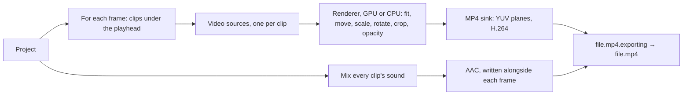

# Media and export

How Kadr reads media files, keeps sound and pictures in sync, and writes the final
video. Code: `kadr-media`, `kadr-render`, `kadr-engine`.

## The backend traits

The engine never calls FFmpeg directly. It uses a `MediaBackend`:

| Method | Returns |
|---|---|
| `probe(path)` | A `MediaAssetDescription`: kind, duration, picture size, frame rate, sound format |
| `open_video_source(path)` | A `VideoFrameSource`: `frame_at(source_time)` gives the exact picture on screen at that time |
| `decode_audio_segment(request)` | An `AudioBuffer`: a range of sound, at a speed, stereo, at the exact requested length |
| `create_export_sink(settings)` | An `ExportSink`: write video frames and sound in order, then `finish()` |

The desktop implementation is `FfmpegBackend`; Android will get a `MediaCodec` one.

Internally, pictures are `VideoFrame`s — YUV 4:2:0 planes as videos store them, or
RGBA for transparent images (see [rendering.md](rendering.md)) — and sound is
interleaved stereo 32-bit float (`AudioBuffer`), whatever the source file uses.

## Frame-accurate pictures

Compressed video can only be entered at keyframes. To show the frame at time *t*:

1. If *t* is behind the current frame or more than 2 s ahead, jump to the keyframe
   before *t* and flush the decoder.
2. Decode forward. The source keeps **one frame ahead**: the current frame is right
   as long as the next one has not started.
3. Convert only the frame actually shown (once, then shared through `Arc`): 8-bit
   YUV 4:2:0 is copied as is, other layouts are converted.

Requests in increasing order (export, playback) never jump. Still images decode once.

## Sound at the right place and length

For each clip with sound, the engine asks for its source range at its speed and at
**exactly** the clip's length in samples. The FFmpeg backend runs one filter graph:

```text
decoder → atrim (range) → asetpts (restart at 0) → atempo (speed, pitch kept)
        → aresample (project rate) → aformat (float, stereo) → padded / cut to length
```

Clip positions in samples are computed with the same rounding for every clip, so
clips placed end to end leave no gap. Volumes (constant or keyframed) are applied
while mixing.

Measured precision: beeps stay within 1–2 ms at normal speed; `atempo` moves them by
up to about 15 ms when the speed changes, **without drifting**. Both are well under
one frame (33 ms at 30 fps).

## Export, step by step



- The number of frames covers the whole timeline (a partial last frame counts).
- Sound is written alongside each frame so the two streams advance together.
- The file is written as `<name>.exporting` and renamed only on success: a cancelled
  or failed export never leaves a broken file nor replaces a good one.
- Progress is reported after each frame; cancellation is checked before each frame.
- The report's warnings list what was not rendered as asked:
  - a tracked blur without any region;
  - colour adjustments beyond the four a layer takes;
  - a colour LUT whose file cannot be read (the clip is drawn without its look);
  - a second LUT on a clip.

## Encoders

`VideoEncoderPreference::HardwareFirst` tries NVIDIA NVENC, Intel Quick Sync, AMD AMF,
Apple VideoToolbox, then libx264 (then OpenH264). An encoder whose hardware is missing
just fails to open, silently. `SoftwareOnly` always uses libx264, which gives the same
file on every machine (used by tests).

| Setting | libx264 | Hardware encoders |
|---|---|---|
| `Balanced` | preset `medium`, CRF 20 | balanced preset, ≈0.1 bit per pixel (≈6 Mbit/s for 1080p30) |
| `Fast` | preset `veryfast`, CRF 23 | fastest preset, same bit rate |

Keyframes every 2 s; `+faststart` so the file plays while downloading.

## How it is tested

- `kadr-media/tests/ffmpeg_round_trip.rs` writes synthetic videos whose frames show
  their **frame number as a barcode** and whose sound **beeps** every second, then
  checks probing, every frame read back in and out of order, sound ranges and speeds.
- `kadr-engine/tests/export_sync.rs` is the phase 2 acceptance test: three cuts of one
  video, one at 1.5×, plus a music track. Every exported frame must come from the exact
  expected source frame, every beep must be within 20 ms, the music must be present at
  the right volume. Cancellation and empty projects are tested too.

## Performance in phase 2 (CPU, before phase 3a)

Kept for history; current numbers are in [rendering.md](rendering.md).

Measured on the owner's laptop (Intel Core Ultra 9 185H, Intel Arc), per 1080p frame:

| Step | Time |
|---|---|
| Decoding (H.264, multi-threaded) | ≈1 ms |
| YUV → RGBA conversion (swscale, one core) | ≈6 ms |
| Compositing, picture already at canvas size | ≈5 ms |
| Compositing, picture scaled | up to ≈25 ms |
| RGBA → YUV conversion (swscale, one core) | ≈7 ms |
| H.264 encoding with Quick Sync | ≈1 ms |

A 20 s 1080p export took between 16 s and 41 s depending on the laptop's power state
(1.2× to 0.5× real time). The colour conversions and the compositing dominate: phase 3
moves them to the GPU and adds `criterion` benchmarks.

## Known limits

- Text clips and effects are not drawn yet (phase 3).
- Phone videos with a rotation flag are not rotated yet.
- Large downscales (4K into 1080p) use plain bilinear sampling (aliasing possible) until
  the GPU renderer.
- The whole timeline's sound is mixed in memory before encoding (about 23 MB per
  minute): fine for social-media edits, to be streamed for very long projects.
