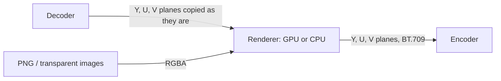

# Rendering

How Kadr turns the pictures visible at one moment into a finished frame. Code:
`kadr-render` (renderers), `kadr-media` (picture types and colour conversions),
`kadr-engine` (which clips are visible).

## Pictures stay in YUV

Videos store pictures as **YUV 4:2:0**: a full-size brightness plane (Y) and two
quarter-size colour planes (U, V). Converting to RGBA and back used to cost more than
decoding and encoding together (phase 2 measurements), so Kadr now keeps YUV from end
to end:

- 8-bit YUV 4:2:0 sources are copied plane by plane, with no conversion.
- Other YUV layouts (4:2:2, 10-bit…) are converted to 8-bit 4:2:0 by swscale.
- RGB and transparent pictures become RGBA.
- **Pass-through**: a single opaque video already at the canvas size and in BT.709 is
  handed to the encoder untouched — nothing is drawn at all.

## Colours

Every YUV ↔ RGB conversion goes through `kadr_media::YuvColorSpace`:

| | Values |
|---|---|
| Matrix | BT.601 (standard definition, JPEG) or BT.709 (HD). Unknown: BT.709 from 720 lines up, BT.601 below, like video players |
| Range | Limited (Y 16–235, the norm for video) or full (0–255). Unknown: limited, except the old `yuvj` formats |

The coefficients are computed once from the matrix weights (Kr, Kb) and the range, and
the **same numbers** feed the CPU conversion code and the GPU shaders. Exports are
always **BT.709, limited range**, and the MP4 says so (colour space, primaries, transfer
characteristic and range tags), so players show the colours as intended. Phase 2
exports were BT.601 without tags, which shifted HD colours slightly.

## The two renderers

Both implement `FrameRenderer::render_frame(canvas, layers) → YUV frame`.
`create_renderer(RendererPreference::GpuIfAvailable)` picks the GPU when one works and
falls back to the CPU otherwise; `kadr-cli render --cpu` forces the CPU.

### GPU (`wgpu`)

Runs on Vulkan, DirectX 12, Metal or OpenGL ES, chosen by `wgpu`.

1. Each layer's picture is uploaded as is: three single-channel textures for YUV (the
   colour conversion happens in the fragment shader), one RGBA texture otherwise.
   Textures are reused from frame to frame.
2. Each layer is drawn onto an RGBA canvas as a quad. Its four corners come from the
   same `LayerGeometry` as the CPU renderer (fit, scale, rotation, position), the crop
   gives the texture coordinates, and straight-alpha blending does the rest.
3. Two passes turn the canvas into the Y plane and, with two render targets at once,
   the U and V planes (each from the average colour of its 2×2 block).
4. The three planes are copied back to the CPU for the encoder.

Shaders: `crates/kadr-render/src/gpu/layers.wgsl` and `yuv_output.wgsl`.

Validation errors from the GPU are captured per frame and returned as
`RenderError::GpuFailure` instead of crashing.

### CPU (reference)

Inverse mapping: for each canvas pixel the layer may cover, find the source point
(undoing position, rotation, scale and crop), sample it bilinearly, blend it. Rows run
in parallel. YUV layers are converted to RGBA first and the result is converted to
BT.709 YUV at the end. The CPU renderer is the **reference**: the GPU must match it.

## Text

Text clips are laid out and rasterised by `cosmic-text` into a transparent RGBA
picture just large enough for the words (plus a margin for overhanging glyphs), then
drawn like any other layer — but at their **native size**: one picture pixel per canvas
pixel (`LayerSizing::NativePixels`), so a 64-pixel font is 64 pixels tall in the video,
before the clip's own scale. Videos and images keep `FitInsideCanvas`.

- **Inter is bundled** (`crates/kadr-render/assets/fonts/InterVariable.ttf`, SIL Open
  Font License 1.1), so the default style looks the same on every machine. The variable
  font names itself "Inter Variable"; styles asking for "Inter" are redirected to it.
- **System fonts** are loaded too: they serve other families a user picks and the
  characters Inter lacks (emoji, many scripts). An unknown family falls back to an
  existing font instead of drawing nothing.
- Line breaks start new lines; lines are not wrapped. Alignment (left, centre, right)
  lines each line up within the widest one.
- The export rasterises each text clip once and reuses the picture while its words and
  style stay the same.

### Subtitles

Subtitle cues use the same font system (`TextRasterizer::rasterize_subtitle`), with
their track's style:

- lines wrap at the style's widest line and are centred;
- `<i>` words are slanted (Inter has no italic face), `<b>` words bold;
- an outline comes from an exact distance transform of the letters' ink, a box is
  drawn behind each line;
- the picture is placed on whole pixels at the style's margin, so both renderers
  copy it exactly.

Only the cues on screen keep their picture. See [subtitles.md](subtitles.md).

## Effects

### Colour adjustment

Exposure, contrast, saturation and temperature, applied to each layer after its
picture is sampled and before it is blended, with the same formula on both renderers
(`color_adjustment.rs` and `adjust_color` in `layers.wgsl`), on colours from 0 to 1:

1. exposure: multiply by 2^stops;
2. contrast: stretch around mid-grey (0.5);
3. saturation: move away from (or towards) the pixel's BT.709 brightness;
4. temperature: add red and remove blue (×0.1 at +1), or the reverse;
5. clamp to 0–1.

A layer takes up to four adjustments, in order; the export report mentions any
further ones it ignored.

### Colour LUTs

A colour LUT gives a clip the look of a `.cube` file (decision record 0052). The
code is in `color_lookup_table.rs`, and `look_up_color` in `layers.wgsl`.

- **Order.** Tracked blurs hide their areas in the source picture first. Then come
  the colour adjustments, in list order, and then the LUT, whatever the order of the
  clip's effects list. One LUT per layer (`MAXIMUM_COLOR_LUTS_PER_LAYER`); the export
  report mentions any further one it ignored.
- **Colours.** The LUT reads the same values as the colour adjustments:
  gamma-encoded, full-range R'G'B' from 0 to 1, after the YUV → RGB conversion, never
  linearised. That is what Rec.709 LUTs expect. LUTs made for log footage (S-Log,
  V-Log…) only look right on log footage.
- **Domain.** Each channel is placed in the file's domain (`DOMAIN_MIN` /
  `DOMAIN_MAX`, or Resolve's `LUT_*_INPUT_RANGE`, 0 to 1 by default), then clamped to
  it.
- **Interpolation.** 3D tables are interpolated trilinearly between the 8 nearest
  colours (red, then green, then blue). 1D tables are interpolated linearly in each
  channel's curve.
- **Strength.** The result is mixed with the colour before the LUT
  (`mix(input, looked_up, strength)`), then clamped to 0–1. A strength of 0 draws
  nothing different, and such a layer may still be passed through untouched.
- **Limits.** 3D sizes run from 2 to 65 and 1D sizes from 2 to 65 536. Files holding
  both a 1D shaper and a 3D cube are refused with a message. Errors give line numbers
  and never quote the file's lines.
- **On the GPU,** a table is an `Rgba32Float` 3D texture at binding 5. A 1D table
  wraps onto rows 256 texels wide.
  - The shader reads it with `textureLoad` and interpolates by hand in the CPU's
    order. `Rgba32Float` is not filterable without the `FLOAT32_FILTERABLE`
    feature, which WARP lacks.
  - Textures are kept by the table's fingerprint while frames use them.
  - Layers without a LUT get a 1×1×1 placeholder. A 65³ table weighs 4.4 MB.
- **Reading files** is the engine's job (`kadr_engine::color_grading`):
  - files over 32 MB are refused before being read;
  - the frame composer keeps the tables it read, by file, and reads one again when
    its modification time or length changes (a look exported again shows on the
    next preview frame);
  - failures are kept too, so a missing file is not looked for on every frame;
  - a LUT that cannot be read is **skipped**: the clip is drawn without its look,
    and the export report names the clip, the effect and the file.
- **Single pictures.** The timeline's pictures (`get_frame` without a clip) show
  LUTs. A clip's own source picture (`clip_pictures_at`) shows the picture before
  colour.

### Tracked blur

A tracked blur hides an area of the **source picture**, before the picture is placed,
so it follows the face whatever the clip's position, scale or rotation, and both
renderers draw the same result.

- The area at a given source time is interpolated between the two nearest
  `RegionSample`s (the nearest one is kept before the first and after the last),
  grown by the effect's margin — by half as much again where the tracker was uncertain
  or lost the face: better to hide too much than to reveal it.
- Shapes: rectangle, or the ellipse inside it. The edge ramps over
  `edge_softness_in_pixels`, centred on the border.
- Styles: **gaussian blur** (three box blurs in a row, about σ = radius / 2, the same
  cost whatever the radius; pixels around the area are read so its edges blur
  naturally), **pixelate** (blocks aligned on the area's corner, each replaced by its
  average), **solid fill** (the colour converted into the picture's own colour space).
- YUV pictures are processed plane by plane (the colour planes at half size), RGBA
  pictures channel by channel with alpha untouched.
- A tracked blur without any region yet is reported by the export (tracking itself
  arrives in phase 4).

## Transitions and text animations

Transitions (fade, slide, zoom) and text animations (fade, slide, pop, type-on, word
by word) need no shader of their own: they only change a layer's opacity, position
and scale (`LayerMotion`, from `transitions.rs`), and type-on texts are rasterised
with part of their letters. During a transition the clip touching the edge is drawn
underneath, its picture continuing past its cut. Details:
[transitions-and-text-animations.md](transitions-and-text-animations.md).

## GPU matches CPU

`crates/kadr-render/tests/gpu_matches_cpu.rs` renders the same scenes on both and
compares the Y, U and V planes: mean difference under 1.5 and fewer than 2 % of values
off by more than 10. Scenes include colour adjustments, colour LUTs, dissolves,
pushes, zooms, animated texts and subtitles with an outline or a box. Remaining differences are expected: the GPU
interpolates colour planes smoothly where the CPU reuses each 2×2 block's colour, and
the edges of rotated layers round differently.

On a real export (17 s, four sources of different sizes and frame rates), the GPU and
CPU files differ by a PSNR of 47 dB on average (52 dB on brightness): invisible.

### Running the GPU tests without a GPU

| Variable | Effect |
|---|---|
| `KADR_GPU_ADAPTER=software` | Use the software adapter: WARP on Windows, lavapipe on Linux (`mesa-vulkan-drivers`) |
| `KADR_REQUIRE_GPU=1` | A missing GPU fails the GPU tests instead of skipping them |

CI sets both on Windows and Linux. On macOS the tests use Metal when available and
are skipped otherwise.

## Performance

Benchmarks (`cargo bench -p kadr-render`), median time per frame on the owner's laptop
(Intel Core Ultra 9 185H, Intel Arc, Vulkan), uploads and read-back included:

| Scene | CPU | GPU |
|---|---|---|
| 720p video scaled to 1080p | 51 ms | **10 ms** |
| Same, with a rotated semi-transparent logo | 257 ms | **15 ms** |
| 720p video scaled to 4K | 295 ms | **25 ms** |
| Same, with the logo, 4K | 266 ms | **37 ms** |

Real exports from the command line (release build, Intel Quick Sync encoder):

| Project | Phase 2 | Phase 3a, CPU | Phase 3a, GPU |
|---|---|---|---|
| 20 s of 1080p, one video at canvas size | 0.5–1.2× real time | 2.7× (pass-through) | 2.1× (pass-through) |
| 17 s, four sources of different sizes | 0.6–1.6× | 0.6× | **1.6×** |

The laptop's power state changes these numbers by up to 2–3× between runs; compare
within one table.

## Known limits

- Large downscales (4K into 1080p) use plain bilinear sampling (possible aliasing);
  mipmaps are future work.
- Hardware decoding is not used yet: decoding 1080p H.264 on the CPU takes about 1 ms
  per frame, so it is not the bottleneck. It becomes interesting for 4K HEVC and with
  zero-copy GPU interop (see decision record 0006).
- Tracked blurs run on the CPU (on the hidden area only, plus one copy of the source
  picture per frame); moving them to the GPU is possible if they ever cost too much.
- Frames are rendered and read back one at a time; overlapping the next frame's upload
  with the current read-back is future work.
