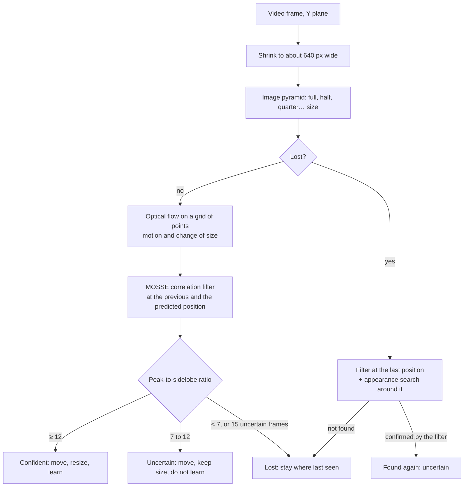

# Tracking and blur

Kadr blurs a face (or a licence plate, a logo, a screen) through a whole clip from a
**single selection**, with **no AI**: no face detector, no neural network, no model
file. The user, or Claude looking at a frame through MCP, draws a box around what must
disappear; a classic tracking algorithm follows that box from frame to frame, and the
blur follows the box.

This document explains the tracker in `kadr-vision`: what it does on each frame, its
settings, how accurate and fast it is, and its limits. The analysis inside the engine
and the `kadr-cli blur` command are described at the end.

See also [decisions/0003](decisions/0003-face-blur-by-classic-tracking.md) (why classic
tracking) and [decisions/0007](decisions/0007-scale-from-point-tracking.md) (how the
size is followed).

## From a selection to a blurred clip

1. The user selects a region on one frame of a clip.
2. The analysis tracks the region **forwards** to the end of the clip and **backwards**
   to its start, from that frame.
3. Each frame gets a region and a confidence: **confident**, **uncertain** or **lost**.
4. The track is smoothed so that the blur does not shake.
5. The tracked regions are stored in the project (`TrackedBlur` samples, see
   [data-model.md](data-model.md)), so the analysis never runs twice for the same
   selection.
6. On export, the blur is drawn on every frame. An uncertain or lost region gets a
   wider margin: blurring too much is better than revealing a face.
7. The interface (phase 7) colours uncertain and lost ranges on the timeline, so that
   the user can correct them quickly.

## The tracker, frame by frame

### 1. A small grey image

The tracker only needs brightness, so it reads the video's Y plane as is, without any
colour conversion. Frames wider than 640 pixels are shrunk by an integer factor
(`shrink_factor_for_tracking`: 2 for 1280, 3 for 1920, 6 for 3840), each pixel being
the average of a block (`GreyImage::from_luma_shrunk`). Following a face needs no more
detail, and everything after this step is up to ten times cheaper.

The image is then put in a **pyramid**: half size, quarter size, and so on. Each
halving blurs gently first (weights 1, 3, 3, 1), so that details too fine for the
smaller image disappear instead of turning into false patterns. Large windows are read
from the smaller levels.

Coordinates: pixel `(column, row)` covers the square from `(column, row)` to
`(column + 1, row + 1)`, so shrinking an image by `k` divides every coordinate by `k`
exactly (`Region::in_shrunk_image`, `Region::in_full_size_image`).

### 2. Optical flow: motion and size

A 4 × 4 grid of points is laid over the middle of the region (from 20 % to 80 % of
each side) and each point is followed with **pyramidal Lucas-Kanade** optical flow
(Lucas and Kanade 1981, Bouguet 2001):

- the window of 15 × 15 pixels around a point should reappear in the new frame,
  shifted; repeated linear steps find the shift from the brightness slopes;
- the search starts from the region's motion in the previous frame (constant speed),
  on a coarse pyramid level, and is refined level after level. The coarsest level is
  limited so that the region still spans 16 pixels there: below that, the windows
  would mostly see the background, which does not move like the region;
- each point is followed back to the previous frame. If it does not return within one
  pixel of where it started, it was badly followed and is ignored (forward-backward
  error, Kalal et al. 2010).

The surviving points give two answers:

- **the motion**: the median of their motions, used to predict where to look for fast
  motions;
- **the change of size**: the median, over every pair of points, of how much their
  distance changed ("Median Flow", Kalal et al. 2010). A face coming 2 % closer makes
  every distance 2 % longer. The change is limited to 5 % per frame.

### 3. The MOSSE correlation filter: where is the region?

The filter (Bolme et al. 2010) finds the region in each new frame:

- **Window.** A square window twice as large as the region's longer side, centred on
  it, is resampled to 64 × 64 cells. The extra context lets the filter find the region
  after it moved.
- **Preprocessing.** The log of the brightness (lighting changes matter less), then a
  mean of 0 and a standard deviation of 1, then a cosine window fading the edges to
  zero (the Fourier transform treats the window as periodic).
- **Training.** The filter is the image whose correlation with the window gives a sharp
  gaussian peak at the centre. In the frequency domain this is one division per
  frequency: `H* = Σ G·F* / (Σ F·F* + λ)`. The first frame gives five training windows,
  slightly rotated (up to 6°), so that a tilting head is still recognised.
- **Detection.** On a new frame the window at the previous position (and at the
  predicted one, when the flow says the region moved at least two cells) is correlated
  with the filter. The response peaks where the region now is; the peak is refined
  between cells with a parabola.
- **Learning.** When the answer is confident, the filter is blended with the new
  window (learning rate 0.125), to follow slow changes of appearance.

### 4. How sure? The peak-to-sidelobe ratio

The **PSR** compares the peak with the rest of the response:
`(peak − mean) / standard deviation`, computed outside an 11 × 11 square around the
peak. A clear, unique match stands far above the rest; an obstacle in front of the face
flattens the response.

| PSR | State | What the tracker does |
|---|---|---|
| ≥ 12 | Confident | Moves the region, applies the measured size, learns the new appearance |
| 7 to 12 | Uncertain | Moves the region, keeps its size, learns nothing (it could be learning the obstacle) |
| < 7 | Lost | Keeps the region where it was last seen |

After 15 uncertain frames in a row, the region is considered lost.

### 5. Finding a lost region again

While lost, the region stays where it was last seen, and every frame:

1. The filter looks at the last position: the obstacle may simply have gone.
2. **Template matching** searches a wider area for the region's appearance, memorised
   while tracking was sure. Two pictures of 16 cells along the longer side are kept:
   the user's selection, and one refreshed every 10 confident frames. Each is slid over
   the area and compared by **normalised cross-correlation** (−1 to 1, insensitive to
   brightness and contrast). The area starts at one region size around the last
   position and grows by 0.1 region sizes per lost frame, up to 3.
3. A candidate with a similarity of at least 0.6 is only accepted if the filter
   confirms it there with a confident PSR. The region is then **uncertain** for that
   frame, and confident again from the next one if the filter agrees.

### 6. Smoothing without lag

The raw track jitters by a fraction of a pixel, which a blur would show as trembling.
`smooth_track` applies a **One Euro filter** (Casiez et al. 2012) to the centre and the
size. It is a low-pass filter whose cutoff rises with speed: strong smoothing when
still, little when moving fast.

- Values are measured in region sizes, so the same settings work at any resolution:
  1 Hz cutoff when still, plus 0.5 Hz per region size per second.
- The filter runs **forwards and backwards** and the two results are averaged. Their
  lags have opposite signs and cancel out: the blur is never late on a moving face.
- Both ends are padded with the straight line that best fits their first frames, so the
  filters have settled by the first real frame.
- Lost frames are left alone; each run of tracked frames is smoothed on its own.

## Settings

| Setting | Value | Where |
|---|---|---|
| Tracking image width | ≤ 640 px | `TRACKING_IMAGE_MAXIMUM_WIDTH_IN_PIXELS` |
| Smallest region side | 8 px in the tracking image (24 px in 1080p) | `MINIMUM_REGION_SIDE_IN_PIXELS` |
| Confident PSR | ≥ 12 | `CONFIDENT_PEAK_TO_SIDELOBE_RATIO` |
| Lost PSR | < 7 | `LOST_PEAK_TO_SIDELOBE_RATIO` |
| Uncertain frames before lost | 15 | `MAXIMUM_UNCERTAIN_FRAMES_IN_A_ROW` |
| Filter window | 2 × the region's longer side, 64 × 64 cells | `correlation_filter.rs` |
| Filter learning rate | 0.125 | `correlation_filter.rs` |
| Size change | ≤ 5 % per frame | `tracker.rs` |
| Optical flow | 4 × 4 points, 15 × 15 windows, up to pyramid level 3, 1 px round-trip error | `optical_flow.rs` |
| Recovery | similarity ≥ 0.6, search from 1 to 3 region sizes | `tracker.rs`, `template_matching.rs` |
| Smoothing | 1 Hz + 0.5 Hz per region size per second, 1 s padding | `smoothing.rs` |

## Accuracy

`crates/kadr-vision/tests/tracking_scenarios.rs` tracks a textured ellipse over a
textured background (`synthetic_scenes`). The true position is known exactly in every
frame. Measured centre errors:

| Scenario | Frames | Mean error | Largest error | States |
|---|---|---|---|---|
| Steady motion, 2.5 px and 1.2 px per frame | 80 | 0.8 px | 1.4 px | all confident |
| The same, tracked backwards | 60 | 0.7 px | 1.2 px | all confident |
| Accelerating from 4 to 36 px per frame (640 × 360) | 20 | 0.1 px | 0.5 px | all confident |
| Coming closer, size × 1.8 | 80 | 1.4 px | 3.1 px | all confident, final size within 2 % |
| Moving away, size × 0.6 | 80 | 2.0 px | 3.2 px | all confident, final size within 2 % |
| Camera pan, background sliding 6 px per frame | 60 | 0.3 px | 0.5 px | all confident |
| Hidden for 15 frames behind an obstacle | 80 | 0.6 px | 1.1 px | lost on the first hidden frame, found again on the first visible one, confident on the next |
| Leaving the frame | 70 | — | — | uncertain at the edge, lost once out |

Run them with `cargo test -p kadr-vision --test tracking_scenarios -- --nocapture` to
see the numbers.

## Speed

Measured with `cargo bench -p kadr-vision` on the owner's laptop, release build,
640 × 360 tracking images:

| Step | Time per frame |
|---|---|
| Shrinking a 1920 × 1080 Y plane to 640 × 360 | 1.2 ms |
| Following a visible region (pyramid, flow, filter, learning) | 3.3 ms (300 frames per second) |
| Searching for a hidden region | 5 ms (200 frames per second) |

A minute of 1080p at 30 frames per second is 1 800 frames: about 8 seconds of tracking,
plus decoding.

## Limits

What the tracker cannot do, and what happens then:

- **A long disappearance.** A face hidden while moving far away, or out of the frame for
  a while, may come back outside the search area (3 region sizes). It stays lost: the
  range is reported, and the user (or Claude) selects it again there.
- **A big change of appearance.** A head turning from front to profile changes the
  picture the filter knows. The filter learns slow changes; a fast turn may make the
  frame uncertain or lost.
- **Something that looks the same.** Two similar objects crossing can make the filter
  jump to the wrong one. The PSR usually drops when they overlap, which marks the range
  as uncertain.
- **Sudden jumps.** Steady fast motion is predicted. A sudden jump of more than about
  half the region's size in one frame (a camera cut) is not: the region is lost, then
  searched for around its last position.
- **Rotation in the image.** Small tilts (up to about 6°) are tolerated; the region
  itself stays an upright rectangle or ellipse.
- **Very small regions.** Below 8 pixels in the tracking image (24 pixels in 1080p)
  there is too little to follow: the selection is refused.

KCF (a kernelised correlation filter with gradient features) can replace MOSSE later if
real videos show the need; the rest of the pipeline would stay the same.

## Testing

- `synthetic_scenes` draws scenes from formulas, so every frame's truth is known.
- Unit tests cover each piece: the Fourier transforms, the pyramid, the filter's peak
  and PSR, optical flow (motion and zoom), template matching, smoothing.
- `tests/tracking_scenarios.rs` checks the whole tracker on the scenarios above.
- `benches/track_region.rs` measures the speed.
- The vision code is optimised even in debug builds (`[profile.dev.package.kadr-vision]`
  in the workspace `Cargo.toml`), so `cargo test` stays quick.

## In the engine and the command line

The analysis of a clip (decoding, forward and backward tracking, storing the samples
in the project) and the `kadr-cli blur` command come in phase 4b and will be described
here.
