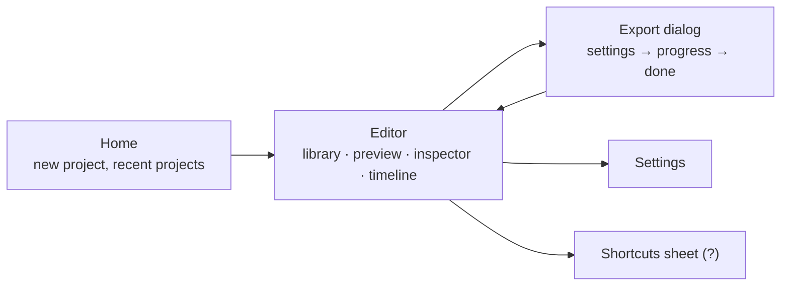
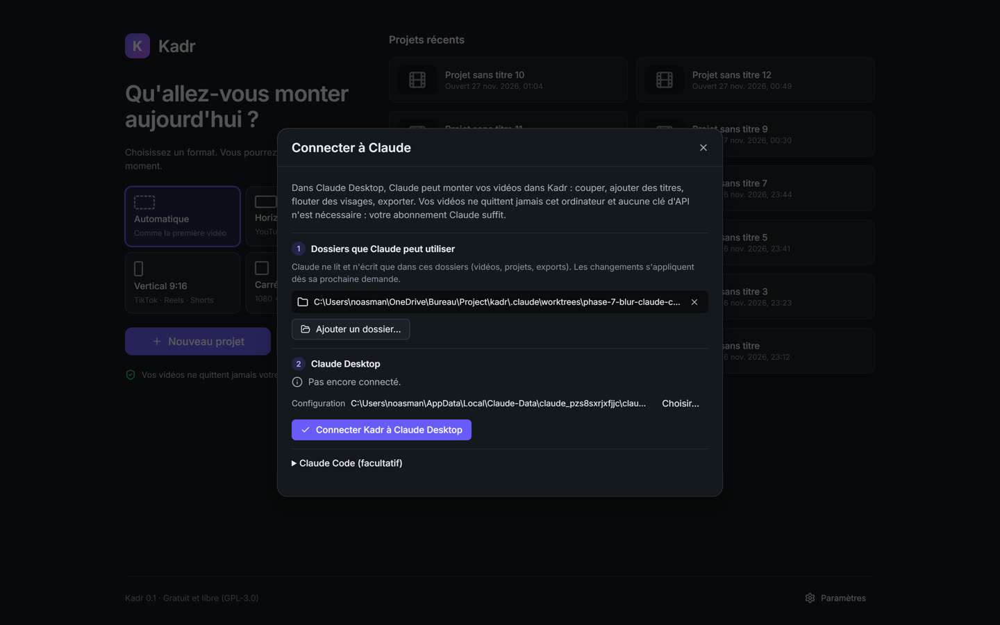

# User experience of the desktop app

How the Kadr desktop app is meant to feel and behave, screen by screen. This is the
reference for phase 6 (desktop MVP); phase 7 adds face blur and Claude to the same
layout.

- **Mockups:** open [mockups/index.html](mockups/index.html) in a browser. Its top bar
  switches between screens, dark and light themes, French and English.
- **Visual language** (colours, spacing, type, components):
  [design-system.md](design-system.md).

## Goals

1. **A beginner makes a first edit without a tutorial.** Import, place, cut, export:
   each step is visible on screen, with a hint where the next action happens.
2. **An experienced editor works fast with the keyboard.** Every frequent action has a
   shortcut, shown in its tooltip and in the `?` sheet.
3. **The picture is the star.** The preview and the timeline take most of the window;
   the side panels can be resized and folded, and the layout is remembered.
4. **Nothing is serious.** Every edit can be undone with Ctrl+Z, the project saves
   itself, and nothing on disk is overwritten without asking.

## Screens



### Home

Shown when the app starts, and when the user clicks the Kadr logo in the editor.

- **New project**, with a format choice: *Automatic* (selected by default: the project
  takes the size and frame rate of the first video placed on the timeline),
  *Landscape 16:9* (1920 × 1080), *Vertical 9:16* (1080 × 1920), *Square 1:1*.
- **Open…** a `.kadr` file.
- **Recent projects**: thumbnail, name, last change, length, format. Clicking opens.
- A reminder that videos never leave the computer.

### Editor

```text
┌──────────────────────────────────────────────────────────────────────────────┐
│ K  Project name ✓ Saved            ↶ ↷ │ 16:9 · 1920×1080 · 30 fps │ ? ⚙ [Export] │
├──────────────┬────────────────────────────────────────────┬──────────────────┤
│ Media │ Text │                                            │ Inspector        │
│ [search]   + │              Preview                       │ (selected clip,  │
│ ▣ ▣          │                                            │  or the project) │
│ ▣ ▣          │                                            │                  │
│ ▣ ▣          │ 00:07:12 / 00:24:00   ⏮ ◀ ▶ ▶ ⏭   quality  │                  │
├──────────────┴────────────────────────────────────────────┴──────────────────┤
│ ✂ 🗑 │ T Add a title                                  🧲 │ − ═══○══ + │ fit    │
│        0:00   0:02   0:04   0:06 ▼ 0:08                                       │
│ T Titles     [ Lisbon, day 1 ]                                                │
│ ▶ Video 1  👁🔊[ tram ][ miradouro ][ pasteis 1.5× ][ logo ]                   │
│ ♪ Music      🔊[ fado-guitar.mp3 ~~~~~~~~~~~~~~~~~~~~~~~~~~~~~~~~ ]            │
└──────────────────────────────────────────────────────────────────────────────┘
```

| Area | Content |
|---|---|
| **Top bar** | Logo (back to Home), project name (rename in place), save state, undo and redo (tooltip names the step: "Undo: split clip"), project format chip (opens the project in the inspector), shortcuts `?`, settings, **Export** |
| **Library** (left) | *Media* tab: imported files as thumbnails with kind icon, length, a check when used in the timeline, and a **+** to add at the end. *Text* tab: title styles to add |
| **Preview** (centre) | The project frame at the playhead, letterboxed to the project format. Transport: timecode, go to start, previous frame, play/pause, next frame, go to end, preview quality |
| **Inspector** (right) | The selected clip's settings, in folding sections; the project's settings when nothing is selected |
| **Timeline** (bottom) | Toolbar (split, delete, add a title, snapping, zoom, fit), ruler, track headers, tracks, playhead |

Minimum window: 1280 × 720. Below 1360 px wide, side panels get narrower; each
panel can be folded to a thin strip, and the timeline height is resizable.

## Main flow: import → edit → export

### 1. Start a project

The user clicks **New project** (format *Automatic* by default). The editor opens
empty:

- the library is one big drop zone: *"Drag your videos here"*, with an **Import
  files** button (Ctrl+I) and the accepted formats;
- the preview says where the picture will appear;
- the timeline shows faint empty tracks and *"Drag a media file here to start your
  edit, or click + on a library thumbnail"*;
- the inspector shows the project format.

The project is saved automatically, from the first change, in
`Documents/Kadr/<project name>.kadr`. **Save as…** moves it elsewhere.

### 2. Import media

- Drag files from the file explorer **anywhere on the window**, or use Import.
- Each file appears at once as a tile with a spinner (*"Reading…"*), then its
  thumbnail and length. Importing never blocks the interface.
- A file Kadr cannot read becomes a red tile: *"Unreadable: notes.txt"*. Its tooltip
  and a notification explain: *"notes.txt is not a video, a picture or a sound Kadr
  can read. Accepted formats: MP4, MOV, MKV, WebM, MP3, WAV, M4A, PNG, JPG."* The
  tile has a remove button.
- Importing the same file twice reuses the existing tile.

### 3. Put clips on the timeline

Two ways, from simplest to most precise:

- **Click + on a tile**: the clip goes at the end of the first track of the right
  kind (videos and pictures on *Video 1*, sounds on *Audio 1*); the track is created
  if needed.
- **Drag a tile onto the timeline**: a ghost shows where the clip will land and
  snaps to clip edges and the playhead (yellow guide line). Dropping:
  - on a free spot of a track of the right kind → the clip goes there;
  - on a spot that is taken → the ghost is red and says why (*"Overlaps
    tram-28.mp4: drop next to it or on another track"*); releasing does nothing;
  - in the *"new track"* area below the tracks → a new track is created for it.

With the *Automatic* format, the first video placed sets the project's size and
frame rate; a notification says so and offers to undo.

### 4. Watch and move around

| Action | Mouse | Keyboard |
|---|---|---|
| Play / pause | Play button | Space |
| Play backwards / pause / forwards | — | J / K / L (press J or L again: 2×, then 4×) |
| One frame back / forward | Arrow buttons | ← / → |
| One second back / forward | — | Shift + ← / → |
| Previous / next cut | — | ↑ / ↓ |
| Jump anywhere | Click or drag on the ruler | Home / End |

Playback plays sound in sync and drops frames rather than slowing down when the
computer cannot keep up. The preview shows exactly what the export will produce:
both use the same renderer.

### 5. Cut and arrange

- **Select**: click a clip (it gets a bright outline and edge handles); click an
  empty spot or press Esc to deselect. Shift + click adds clips to the selection.
- **Split** (S or ✂): cuts the selected clip at the playhead; with nothing
  selected, cuts every clip under the playhead.
- **Delete** (Del or 🗑): removes the selected clips and leaves the gap. A
  notification offers *Undo*.
- **Move**: drag a clip along its track or to another track of the same kind. Same
  ghost, snapping and refusal rules as when dropping from the library. Alt while
  dragging turns snapping off for that gesture.
- **Trim**: drag a selected clip's edge. A bubble shows the new length; the preview
  shows the frame at the edge. A clip cannot be stretched past the end of its file.
- **Snapping** (🧲 or N): to clip edges, the playhead and the start of the timeline,
  within 8 screen pixels. On by default.
- **Zoom**: slider, + / −, Ctrl + mouse wheel (centred on the mouse), *Fit* (Shift+Z).
- **Tracks**: hide a video track (👁), mute any track with sound (🔊). An empty
  track can be removed from its header's menu.
- **Undo / redo**: Ctrl+Z / Ctrl+Y (also Ctrl+Shift+Z), or the top-bar arrows whose
  tooltips name the step.

Clips show what they contain, never by colour alone: an icon and the file name on
every clip; thumbnails along video clips; a waveform along anything with sound; the
speed (*1.5×*) and a changed volume (*60 %*) as badges.

### 6. Adjust a clip (inspector)

Changes show in the preview immediately; each finished gesture (a slider released, a
value typed) is one undo step.

| Section | Settings | Shown for |
|---|---|---|
| **Picture** | Position X/Y (pixels), scale (%), rotation (°), opacity (%). *Advanced: crop* (left, top, right, bottom) | Videos, pictures, titles |
| **Sound** | Volume (0–400 %) | Clips with sound |
| **Speed** | 0.5×, 1×, 1.5×, 2×, or a custom value. Voices keep their pitch; the clip's length changes, later clips do not move (a longer clip that would overlap is refused with a message) | Videos and sounds |
| **Colour** | Exposure, contrast, saturation, temperature; off until first touched. Then a **LUT**: *Choose a .cube file…* (DaVinci Resolve, Premiere…), its strength (0–100 %, field and slider), *Choose another LUT*, *Remove the LUT*. The LUT applies after the four settings. *Reset* removes both | Videos and pictures |
| **Text** | Words, font, size, colour, alignment, duration | Titles |
| **Blur** | Each tracked blur: style, strength, shape, margin, on / off, delete; *Add* starts the blur tool (see [Blurring a face](#blurring-a-face-phase-7)) | Videos |

Number fields accept typing, arrow keys (Shift for bigger steps) and dragging
sideways on the field. Each section has a *Reset*.

A value animated with keyframes (by Claude, for example) shows *"Animated (3
keyframes)"* and cannot be changed to a single value from the inspector yet:
keyframe editing arrives in phase 8.

With nothing selected, the inspector shows the **project**: format (16:9, 9:16, 1:1
or a custom size), frame rate, background colour, and the project's length.

### 7. Add a title

*Add a title* (toolbar), the *Text* tab or **T** adds a title at the playhead, on a
*Titles* track above the videos (created if needed), 3 seconds long, selected, with
the inspector's text field focused. The *Text* tab offers a few ready-made styles
(title, subtitle at the bottom, big centred word).

### 8. Export

**Export** (Ctrl+E) opens a dialog:

- **Presets** on the left: *Project format* (suggested), *YouTube 1080p*, *YouTube 4K*,
  *TikTok · Reels · Shorts* (1080 × 1920), *Square*. A preset whose shape differs from
  the project (vertical for a horizontal project) shows: *"This preset is vertical;
  your project is horizontal. Kadr will switch the project to vertical and refit the
  clips. You can undo it with Ctrl+Z."*
- **File name** (the project name) and **folder** (the Videos folder, or the last one
  used), with *Choose…*. An existing file is never replaced without a confirmation.
- **Quality**: *High* (suggested) or *Fast (larger file)*. *Advanced*: hardware
  encoder when possible, or software only.
- A summary: length, estimated size, MP4 · H.264 · AAC.

Then **progress**: percentage, frame count, elapsed and remaining time, the encoder
used, *Cancel export*, and *Keep editing* (the dialog folds into a progress pill in
the top bar; the export uses the project as it was when it started).

Then **done**: the file with its size and export time, *Show in folder*, *Play the
video*. Or a **human error**: what happened, why, what to do (*"The disk is full…
Free some space or pick another folder, then try again. Your previous file was not
touched."*), with *Try again* and *Copy the details*.

## Blurring a face (phase 7)

What the person wants: hide a face (or a licence plate, a screen) through a whole
clip, without drawing it frame by frame, and be sure nothing shows.

### 1. Select the region

1. The playhead is on a frame where the face is clearly visible.
2. **Blur a region** (the preview's toolbar, **B**, or *Add a blur* in the inspector's
   *Blur* section) turns the preview into a drawing surface: the cursor becomes a
   cross, a hint says *"Draw a box around the face to blur"*.
   - The clip blurred is the **selected video clip**, or the top video clip under the
     playhead when none is selected. With no video under the playhead the button is
     disabled and its tooltip says why.
3. The person drags a box over the face. It stays on screen with eight handles and a
   small bar: **Blur and follow** (Enter) and **Cancel** (Escape). Dragging inside the
   box moves it, dragging a handle resizes it. A box too small to follow (24 pixels in
   1080p) shows *"Too small to follow: draw a larger box"* and the button is disabled.

The box is drawn on the canvas, but stored in the source video's pixels: moving,
scaling or cropping the clip later keeps the blur on the face.

### 2. Follow it

**Blur and follow** starts the analysis, forwards and backwards from that frame:

- a card on the preview shows *"Following the face… 42 % · about 6 s left"* with
  **Cancel**; editing goes on meanwhile (the result is added when it ends, as its own
  undo step);
- when it ends, the blur appears on the clip, in the preview at once, and a
  notification says *"Face blurred through the clip"*, or *"Face blurred · 2 moments
  to check"* with **Check** when the tracker was unsure somewhere;
- an analysis that fails says why (*"The box has no detail to follow: draw it around
  the whole face, hair included"*), with nothing changed.

Only one analysis runs at a time; **Blur a region** is disabled meanwhile, its tooltip
says why.

### 3. See it and adjust it (inspector, *Blur* section)

Shown for videos. One block per blur of the clip (several faces, several blurs):

| Setting | Choices |
|---|---|
| Style | **Blur** (default), **Pixels**, **Mask** (solid colour) |
| Strength | Blur radius or square size, in pixels; colour for the mask |
| Shape | **Ellipse** (faces, default) or **Rectangle** (plates, screens) |
| Margin | Extra hidden space around the box, 0–100 %, default 20 % |
| On / off, Delete | The eye hides the blur without deleting it; delete is undoable |

While the clip is selected and the playhead is inside it, the preview draws each
blur's **box** at that moment: a thin outline, solid where the tracker was sure,
dashed with a ⚠ where it was not. The outline never shows in the export.

### 4. Check and correct (7c)

- Stretches where the tracker was **uncertain** or **lost** are drawn on the clip in
  the timeline: amber stripes (uncertain) or red stripes (lost), with a ⚠ icon, so the
  information is not carried by colour alone. Their tooltip says *"Check: the tracker
  was unsure from 0:12.4 to 0:13.1"*.
- **Next moment to check** (in the *Blur* section, and **Shift+B**) puts the playhead
  in the middle of the next stretch and selects the clip.
- To correct, the person drags the box (or its handles) where the face really is on
  that frame, then **Correct from here** (Enter): the analysis runs again from that
  frame, both ways, up to the neighbouring corrections or the original selection, and
  keeps the surer answer frame by frame. The correction is one undo step. Ten seconds
  are enough for a typical correction: go to the stretch, drag, Enter.
- When nothing is left to check, the *Blur* section says *"Followed with confidence on
  every frame"*.

## Subtitles (phase 8g)

The model and the drawing are in [subtitles.md](subtitles.md).

1. **Import.** *Import subtitles (.srt)…* in the *Text* tab, or drop an `.srt` file
   on the window (the import dialog takes them too). A new subtitle track appears on
   top, named after the file; the first cue is selected, and the notice says how many
   cues came in, with what was fixed to read the file in its details, and offers Undo.
   A broken file changes nothing: the notice names the line to fix.
2. **See.** The preview shows the subtitles as the export will: white letters with a
   black outline, a quarter of the height above the bottom on a vertical project.
   Cues are amber clips with the captions icon on their track: drag, trim, **S** to
   split, Delete, as with any clip, only between subtitle tracks.
3. **Fix a cue** (inspector, *Subtitle*): the words (`<i>` and `<b>` work; Ctrl+Enter
   validates, Esc cancels), *Start* and *End* to the millisecond, *Split at the
   playhead*, *Merge with the next*, *Delete*. *Add a subtitle at the playhead* (the
   *Text* tab and the timeline's toolbar) adds a two-second cue and focuses its words.
4. **Style** (inspector, *Style of the track*, shared by every cue of the track):
   font, size, bold, colour, outline / box / nothing and its colour, outline width,
   bottom or top, margin, widest line.
5. **Export.** The video export burns them in. *Export as .srt…* writes the corrected
   file.

Removing silences also removes the same moments from the subtitles, so they stay on
the voice. A subtitle track can be hidden (eye), not muted.

## Claude in the app (phase 7)

What the person wants: talk to Claude in Claude Desktop while the edit is open, and
see what Claude does, as it does it.

- Every change Claude makes shows **at once**: the preview, the timeline and the
  inspector follow, a notification says *"Claude a modifié le projet : Split clip 3 at
  0.5 s"* with **Undo**, and the clips Claude touched are outlined for a moment (a
  steady outline when animations are reduced).
- Claude's steps are in the **same history**: Ctrl+Z undoes them like any other, and
  the undo button's tooltip reads *"Annuler : Claude : …"*. Claude itself can only
  undo its own steps.
- When Claude opens or creates a project, the window shows it: *"Claude a ouvert
  « … »"*.
- Faces Claude blurs appear when their analysis ends, with the same notification.
- The person keeps editing meanwhile: Claude's calls and the person's gestures take
  turns, never mix.

### Connecting Claude (Settings → Claude)

What the person wants: let Claude Desktop use Kadr without editing any file by hand,
and say which folders Claude may touch.

1. **Settings → Claude → *Connecter à Claude…*** opens a dialog. It says in one
   sentence what Claude can do and that the videos never leave the computer.
2. ***Dossiers que Claude peut utiliser***: the list of allowed folders, each with a
   remove button; a folder that no longer exists is marked *Introuvable*. *Ajouter un
   dossier…* opens the system's folder picker. With no folder yet, the list says to
   add the one holding the videos. Changes apply at Claude's next request.
3. ***Claude Desktop***: the configuration file Kadr found (or *Choisir…* another
   one), and a status line:
   - *Connecté*: Claude Desktop starts this Kadr;
   - *Pas encore connecté*;
   - *another copy of Kadr, or a configuration made by hand*: Connect replaces it;
   - *not valid JSON*: Kadr will not change it, and says how to fix it;
   - *kadr-mcp not found next to the app*: says how to build or reinstall it.
4. **Connecter Kadr à Claude Desktop** (*Reconnecter* when already connected)
   writes the entry, then says to quit Claude Desktop completely and reopen it.
5. ***Claude Code (facultatif)***: the `claude mcp add` command, with *Copier la
   commande* (and a message to copy it by hand if the clipboard refuses).



## States every screen handles

| State | What the user sees |
|---|---|
| Empty | An explanation and the next action (drop zone, *"Drag a media file here…"*) |
| Loading | A spinner where the content will be; the rest stays usable |
| Error | What happened, why, what to do; never a raw code. Engine messages are translated for the cases the app knows, and shown as they are otherwise |
| Long text | Names are cut with an ellipsis and shown whole in a tooltip; French, about 20 % longer than English, is the reference for widths |
| Missing file | A media file moved since the project was saved: its tile and clips are marked *Missing*, the preview shows a placeholder. A LUT file moved: the clip is shown without its look, and the inspector says so under the LUT's name (*"… cannot be found: … Choose the file again."*). Relinking arrives after the MVP |

## Notifications

Small cards at the bottom of the preview, for 5 seconds (longer when they hold an
action), never stacking more than three:

- after destructive or surprising actions, with **Undo**: clip deleted, format changed
  by the first video, format changed for an export preset;
- background work finished: export done (with *Show in folder*), a face blurred
  through a clip (with *Undo*, and how many moments to check);
- errors that are not tied to a dialog (an unreadable imported file).

## Keyboard shortcuts

The full list is also in the app (`?`). Shortcuts do not fire while typing in a field.

| Group | Action | Keys |
|---|---|---|
| Playback | Play / pause | Space |
| | Backwards / pause / forwards (repeat for 2×, 4×) | J / K / L |
| | Previous / next frame | ← / → |
| | One second back / forward | Shift + ← / → |
| | Previous / next cut | ↑ / ↓ |
| | Start / end | Home / End |
| Editing | Split at the playhead | S |
| | Delete the selection | Delete, Backspace |
| | Undo / redo | Ctrl+Z / Ctrl+Y, Ctrl+Shift+Z |
| | Deselect | Esc |
| | Add a title at the playhead | T |
| | Blur a region (draw a box on the preview); then Enter to follow it, Esc to leave, arrows to move the box | B |
| | Next moment of a blur to check | Shift+B |
| Timeline | Zoom in / out | + / − , Ctrl + wheel |
| | Fit the whole edit | Shift+Z |
| | Snapping on / off | N |
| | Drag without snapping | Alt (held) |
| Project | Import files | Ctrl+I |
| | Export | Ctrl+E |
| | Save (automatic anyway) / save as | Ctrl+S / Ctrl+Shift+S |
| | New / open | Ctrl+N / Ctrl+O |
| Help | This list | ? |

Customisable shortcuts are planned after the MVP; the sheet already lists them in
one place.

## Languages

French and English from the start. The language follows Windows (French if Windows
is in French, English otherwise) and can be changed in the settings without
restarting. Every string lives in a translation file, keyed by meaning; numbers,
sizes and dates use the language's conventions (*17,6 Mo* / *17.6 MB*).

## Accessibility

- Contrast at least WCAG AA in both themes (checked token by token in
  [design-system.md](design-system.md)).
- Everything works with the keyboard: logical tab order, visible focus ring, panels
  reachable with F6, the timeline navigable with arrows when focused.
- Icons always have a label (tooltip and `aria-label`); information is never carried
  by colour alone.
- Interface size 80–150 % in the settings; `prefers-reduced-motion` is respected.

## What the MVP leaves for later

| Later | Phase |
|---|---|
| *Connect to Claude* screen | 7 |
| Moving and resizing clips directly in the preview, with guides | 7 |
| Transitions, keyframe curves, silence removal, stabilisation, subtitles | 8 |
| First-launch tour and sample project; customisable shortcuts; relinking moved files | after the MVP |

The layout keeps room for them: phase 7's blur tools live in the inspector (a
*Blur* section) and on the preview, Claude's status in the top bar.
